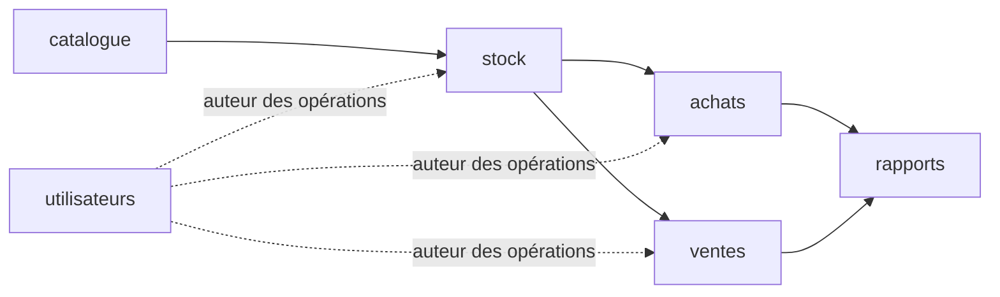
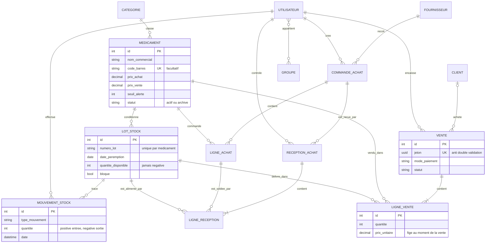
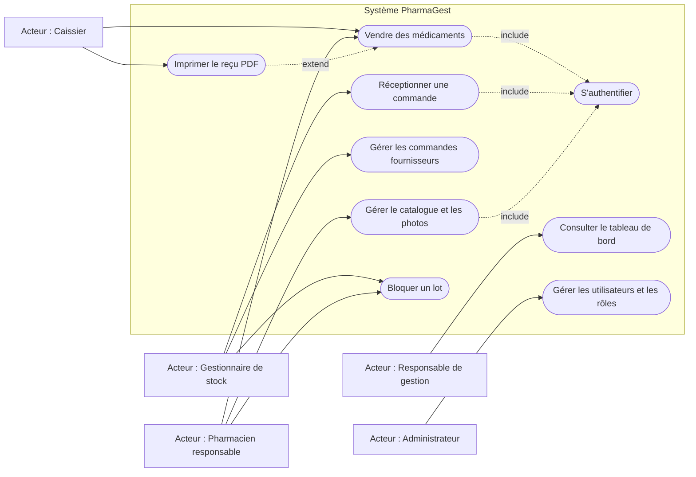
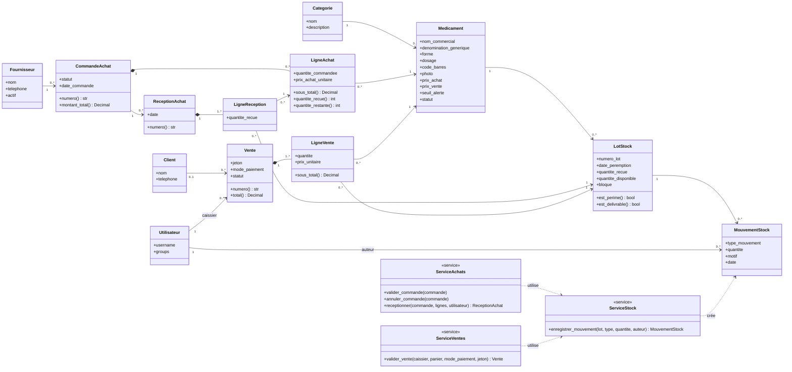
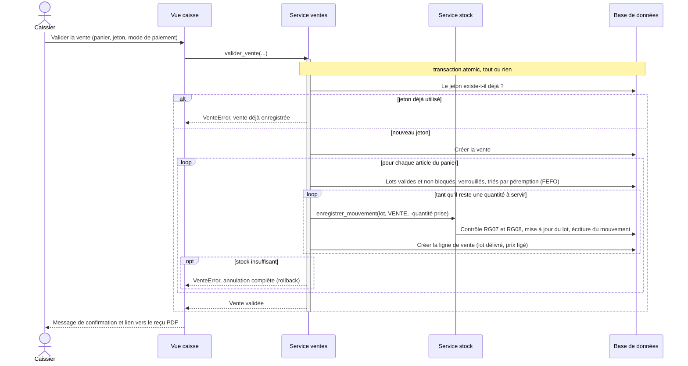
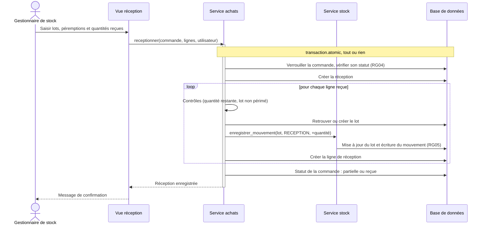
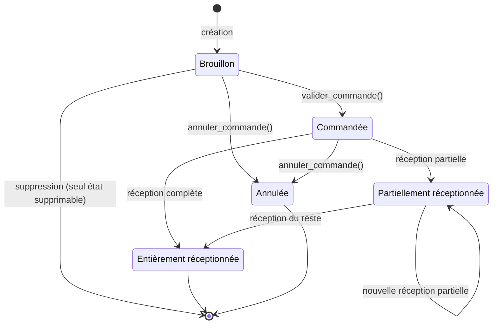

# Dossier de conception - PharmaGest

Ce dossier décrit la structure des données (MCD, MLD) et le fonctionnement de l'application
(diagrammes UML) tels qu'ils sont **réellement implémentés** dans le code. Les éléments prévus
par le cahier des charges mais non réalisés sont listés à la fin, dans « Écarts ».

Les diagrammes sont écrits en Mermaid : GitHub les affiche directement. Pour les exporter en
image (PNG ou SVG), coller le bloc de code sur https://mermaid.live.

## 1. Organisation du projet

| Application Django | Responsabilité | Modèles |
|---|---|---|
| `utilisateurs/` | Comptes, groupes, permissions | `Utilisateur` |
| `catalogue/` | Référentiel des produits | `Categorie`, `Medicament` |
| `stock/` | Lots, journal et service de stock | `LotStock`, `MouvementStock` |
| `achats/` | Fournisseurs, commandes, réceptions | `Fournisseur`, `CommandeAchat`, `LigneAchat`, `ReceptionAchat`, `LigneReception` |
| `ventes/` | Caisse, ventes, reçu PDF | `Client`, `Vente`, `LigneVente` |
| `rapports/` | Tableau de bord, données de démonstration | aucun |

Les dépendances vont dans un seul sens, ce qui évite les imports circulaires :

Seul le service `stock/services.py` (`enregistrer_mouvement`) modifie la quantité d'un lot.
Les achats et les ventes l'appellent, ce qui place les règles de stock à un seul endroit.

## 2. Modèle conceptuel de données (MCD)

### 2.1 Entités

| Entité | Identifiant | Propriétés |
|---|---|---|
| CATEGORIE | id | nom (unique), description |
| MEDICAMENT | id | nom_commercial, denomination_generique, forme, dosage, laboratoire, code_barres (unique si renseigné), photo, prix_achat, prix_vente, seuil_alerte, statut, date_creation |
| LOT_STOCK | id | numero_lot, date_peremption, quantite_recue, quantite_disponible, bloque, date_creation |
| MOUVEMENT_STOCK | id | type_mouvement, quantite (signée), motif, date |
| FOURNISSEUR | id | nom, adresse, telephone, email, numero_fiscal, contact_principal, actif |
| COMMANDE_ACHAT | id | statut, date_creation, date_commande, notes |
| LIGNE_ACHAT | id | quantite_commandee, prix_achat_unitaire |
| RECEPTION_ACHAT | id | date, notes |
| LIGNE_RECEPTION | id | quantite_recue |
| CLIENT | id | nom, telephone, actif |
| VENTE | id | jeton (unique), mode_paiement, statut, date |
| LIGNE_VENTE | id | quantite, prix_unitaire |
| UTILISATEUR | id | identifiant, mot de passe (haché), nom, prénom, email, statuts |
| GROUPE | id | nom |

### 2.2 Associations et cardinalités (notation Merise)

| Association | Entité A (card.) | Entité B (card.) | Lecture |
|---|---|---|---|
| CLASSER | MEDICAMENT (1,1) | CATEGORIE (0,n) | Un médicament appartient à une seule catégorie ; une catégorie regroupe zéro ou plusieurs médicaments. |
| CONDITIONNER | LOT_STOCK (1,1) | MEDICAMENT (0,n) | Un lot concerne un seul médicament ; un médicament a zéro ou plusieurs lots. |
| TRACER | MOUVEMENT_STOCK (1,1) | LOT_STOCK (0,n) | Un mouvement porte sur un seul lot. |
| EFFECTUER | MOUVEMENT_STOCK (1,1) | UTILISATEUR (0,n) | Chaque mouvement a un auteur. |
| PASSER | COMMANDE_ACHAT (1,1) | FOURNISSEUR (0,n) | Une commande est adressée à un seul fournisseur. |
| CREER | COMMANDE_ACHAT (1,1) | UTILISATEUR (0,n) | Chaque commande a un auteur. |
| COMPOSER_ACHAT | LIGNE_ACHAT (1,1) | COMMANDE_ACHAT (0,n) | Une commande en brouillon peut être vide. |
| COMMANDER | LIGNE_ACHAT (1,1) | MEDICAMENT (0,n) | Une ligne commande un seul médicament. |
| RECEVOIR | RECEPTION_ACHAT (1,1) | COMMANDE_ACHAT (0,n) | Une commande peut être reçue en plusieurs fois. |
| CONTROLER | RECEPTION_ACHAT (1,1) | UTILISATEUR (0,n) | Chaque réception a un auteur. |
| COMPOSER_RECEPTION | LIGNE_RECEPTION (1,1) | RECEPTION_ACHAT (1,n) | Une réception contient au moins une ligne. |
| SOLDER | LIGNE_RECEPTION (1,1) | LIGNE_ACHAT (0,n) | Une ligne commandée peut être livrée en plusieurs fois. |
| ALIMENTER | LIGNE_RECEPTION (1,1) | LOT_STOCK (0,n) | Une ligne reçue alimente un seul lot. |
| ACHETER | VENTE (0,1) | CLIENT (0,n) | Le client est facultatif (vente au comptoir). |
| ENCAISSER | VENTE (1,1) | UTILISATEUR (0,n) | Chaque vente a un caissier. |
| COMPOSER_VENTE | LIGNE_VENTE (1,1) | VENTE (1,n) | Une vente contient au moins une ligne. |
| VENDRE | LIGNE_VENTE (1,1) | MEDICAMENT (0,n) | Une ligne vend un seul médicament. |
| DELIVRER | LIGNE_VENTE (1,1) | LOT_STOCK (0,n) | Une ligne indique le lot réellement délivré. |
| APPARTENIR | UTILISATEUR (0,n) | GROUPE (0,n) | Un utilisateur peut avoir plusieurs rôles. |

Les lignes (achat, réception, vente) sont des entités et non des associations porteuses :
`LIGNE_RECEPTION` doit pouvoir référencer une `LIGNE_ACHAT` précise, ce qui impose un identifiant.

### 2.3 Schéma entité-association

## 3. Modèle logique de données (MLD)

Notation : clé primaire soulignée en texte par `id`, clé étrangère précédée de `#`.
Les tables Django réelles sont préfixées par le nom de l'application (`catalogue_medicament`, etc.).

- **CATEGORIE** (id, nom, description)
- **MEDICAMENT** (id, nom_commercial, denomination_generique, forme, dosage, laboratoire, code_barres, photo, prix_achat, prix_vente, seuil_alerte, statut, date_creation, #categorie_id)
- **LOT_STOCK** (id, numero_lot, date_peremption, quantite_recue, quantite_disponible, bloque, date_creation, #medicament_id)
- **MOUVEMENT_STOCK** (id, type_mouvement, quantite, motif, date, #lot_id, #auteur_id)
- **FOURNISSEUR** (id, nom, adresse, telephone, email, numero_fiscal, contact_principal, actif)
- **COMMANDE_ACHAT** (id, statut, date_creation, date_commande, notes, #fournisseur_id, #cree_par_id)
- **LIGNE_ACHAT** (id, quantite_commandee, prix_achat_unitaire, #commande_id, #medicament_id)
- **RECEPTION_ACHAT** (id, date, notes, #commande_id, #recu_par_id)
- **LIGNE_RECEPTION** (id, quantite_recue, #reception_id, #ligne_achat_id, #lot_id)
- **CLIENT** (id, nom, telephone, actif)
- **VENTE** (id, jeton, mode_paiement, statut, date, #client_id, #caissier_id)
- **LIGNE_VENTE** (id, quantite, prix_unitaire, #vente_id, #medicament_id, #lot_id)
- **UTILISATEUR** (id, username, password, first_name, last_name, email, is_staff, is_superuser, is_active, last_login, date_joined)
- **GROUPE** (id, name)
- **UTILISATEUR_GROUPES** (#utilisateur_id, #groupe_id)

### Contraintes d'intégrité

| Contrainte | Où | Rôle |
|---|---|---|
| `UNIQUE (code_barres)`, valeur `NULL` autorisée | MEDICAMENT | RG02 : pas de doublon, mais plusieurs médicaments sans code |
| `UNIQUE (medicament_id, numero_lot)` | LOT_STOCK | Un numéro de lot n'existe qu'une fois par médicament |
| `CHECK (quantite_disponible >= 0)` | LOT_STOCK | RG07, filet de sécurité au niveau de la base |
| `UNIQUE (commande_id, medicament_id)` | LIGNE_ACHAT | Un médicament par commande |
| `UNIQUE (jeton)` | VENTE | RG06 : une validation répétée est refusée |
| `ON DELETE PROTECT` | toutes les clés étrangères sauf les lignes | RG10 : rien ne disparaît en cascade |
| `ON DELETE CASCADE` | lignes vers leur document | Une ligne n'existe que dans son document (brouillon supprimable) |

## 4. Diagrammes UML

### 4.1 Cas d'utilisation

Mermaid n'a pas de diagramme de cas d'utilisation natif : la figure ci-dessous en est une
représentation équivalente (acteurs à gauche, cas d'utilisation au centre). L'administrateur
hérite de tous les cas d'utilisation des autres acteurs.

### 4.2 Diagramme de classes

### 4.3 Diagramme de séquence : valider une vente

Ce scénario couvre RG06 (pas de double sortie), RG07 (pas de stock négatif), RG08 (lots
périmés ou bloqués exclus), RG12 (prix figé) et la règle FEFO.

### 4.4 Diagramme de séquence : réceptionner une commande

### 4.5 Diagramme d'états : commande d'achat

Seul un brouillon peut être modifié ou supprimé. Une commande validée est figée, ce qui
garantit que le stock reçu correspond toujours à ce qui a été commandé.

## 5. Traçabilité des règles de gestion

| Règle | Implémentation | Vérifiée par |
|---|---|---|
| RG01 Identifiant unique | Clé primaire automatique de chaque modèle | Structure de la base |
| RG02 Code-barres non dupliqué | `unique=True, null=True` sur `Medicament.code_barres` | Contrainte de base de données |
| RG03 Validation serveur | Valideurs des modèles, formulaires Django, contrôles des services | `catalogue/tests.py`, `stock/tests.py` |
| RG04 Commande sans effet sur le stock | Seul `receptionner()` appelle le service de stock | `achats/test_services.py` |
| RG05 Réception comptée une fois | Transaction atomique, contrôle du reste à recevoir | `achats/test_services.py` |
| RG06 Vente comptée une fois | Jeton unique, transaction atomique | `ventes/tests.py` |
| RG07 Stock jamais négatif | Contrôle dans `enregistrer_mouvement`, `CHECK` en base | `stock/tests.py`, `ventes/tests.py` |
| RG08 Lots périmés ou bloqués exclus | `LotStock.est_delivrable`, filtre FEFO de la vente | `stock/tests.py`, `ventes/tests.py` |
| RG09 Auteur, date, historique | Champs `auteur`, `cree_par`, `recu_par`, `caissier` ; journal en lecture seule | Admin verrouillé |
| RG10 Pas de suppression sans traçabilité | `on_delete=PROTECT`, archivage des médicaments, suppression limitée aux brouillons | Admin verrouillé, `catalogue/tests.py` |
| RG11 Accès aux seules fonctions autorisées | Groupes Django, `permission_required` sur chaque vue | `catalogue/tests.py`, `rapports/test_donnees_demo.py` |
| RG12 Prix historiques conservés | Prix copiés sur `LigneAchat` et `LigneVente` | `achats/tests.py`, `ventes/tests.py` |

## 6. Écarts avec le cahier des charges

| Prévu | Décision dans cette version |
|---|---|
| Table `Paiement` | Le mode de paiement est un champ de `Vente` (paiement unique, saisi à la main) |
| Table `RetourVente` | Non réalisée : les retours et remboursements ne sont pas gérés |
| Table `JournalAudit` | Non réalisée : la traçabilité repose sur les auteurs et dates des opérations et sur le journal des mouvements de stock |
| Apps `medicaments`, `fournisseurs`, `clients` séparées | Regroupées dans `catalogue`, `achats` et `ventes` pour limiter les dépendances croisées |
